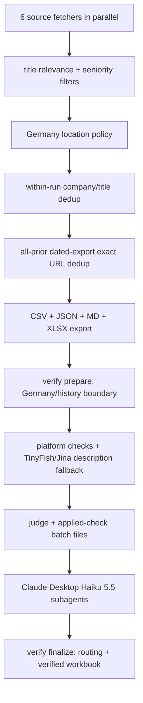

# Architecture

Technical details for the Jobscraper pipeline and verification post-step. Windows + Claude Desktop only.

## Pipeline Flow

Candidate-specific settings (titles, filters, skill keywords, paths) live in
`config.py`; every other module imports from it. The fetchers run together via
`ThreadPoolExecutor`; each is independent and results are collected at the end.

Windows details: `config.py` forces a UTF-8 console, all file I/O names its
encoding, and scratch batches live in `.work\` next to the code (no `/tmp`, no
hard-coded home directories).

## Filter Chain

Every scraped job passes through `check_experience_and_location()`; ATS results
use the same helpers from `config.py` and `location_policy.py`:

1. **Title relevance** (`config.is_relevant_title`) - needs a plant / lab /
   food-safety / horticulture keyword and no software or unrelated-trade marker.
2. **Seniority ceiling** - rejects senior, lead, principal, staff, manager,
   head, architect, and director titles. Required experience years are judged
   from the full description by Haiku during verification.
3. **Germany location evidence** - requires Germany/Deutschland, a structured
   `DE` country segment, a German state, or an unambiguous German city. Unknown,
   blank, and remote-region-only locations are not treated as Germany.
4. **Role type** - Working Student, Internship or Full-Time / Entry-Level. All
   three are Germany-wide.

`verify_jobs.py prepare` applies the same location policy before any routing, so
foreign/unknown rows from older inputs never appear in any output sheet.

## Freshness Filtering (24h)

| Platform | Server-side filter | Post-filter | No-date behavior |
|---|---|---|---|
| Arbeitnow | - | `created_at` vs 24h cutoff | N/A (API always has timestamp) |
| Xing | - | `<time dateTime>` vs cutoff | Include (sponsored listings are real jobs) |
| Stepstone | `ag=age_1` (24h) | `parse_stepstone_timeago()` vs cutoff | Include (defaults to now) |
| LinkedIn | `f_TPR=r86400` (24h) | `posted_at` datetime vs cutoff | Include (safety net only) |
| Indeed | GraphQL `dateOnIndeed` with `start: "24h"` | `dateOnIndeed` or `datePublished` vs cutoff | Include when no timestamp is available |
| ATS: Greenhouse | - | `first_published` vs cutoff | Include (via `_is_fresh`) |
| ATS: SmartRecruiters | - | `releasedDate` vs cutoff | Include (via `_is_fresh`) |
| ATS: Ashby | - | `publishedDate` vs cutoff | Include (via `_is_fresh`) |

## Deduplication

| Scope | Stage | Method | Behavior |
|---|---|---|---|
| Within-run | Before export | `normalize_key()` on company + title | Removes same-run name/title variants |
| Cross-run | Before export and verification | `load_seen_job_urls()` + `normalize_job_url()` | Exact stable posting URL identity across every earlier dated export; no cross-date title/company matching |

`normalize_job_url()` canonicalizes LinkedIn numeric job IDs and Indeed `jk`
IDs, normalizes scheme/host, removes recognized tracking keys, and preserves
case-sensitive generic paths and unrecognized query parameters in deterministic
order. History scans exclude current/future dates and fail visibly on unreadable
exports. The current-date export is preserved on same-day reruns after the
same Germany and historical-URL checks. Historical outputs are never rewritten.

## Verification Post-Step

Verification is a three-phase hand-off because the judge is Claude Haiku 5.5
running as Claude Desktop subagents:

1. `python verify_jobs.py prepare`
2. Haiku subagents (SKILL.md Step 3) read batch files and write result files
3. `python verify_jobs.py finalize`

### Prepare

`prepare_verification()` removes foreign/unknown locations, sends rows whose
exact URL appears in an earlier dated export to **Previously Seen** (no platform
requests, no judging), injects descriptions from the sibling JSON, runs the
platform verifiers, detects LinkedIn reposts, and then
`acquire_missing_descriptions()` fetches still-missing descriptions via
TinyFish and then Jina Reader (`fetchers.py`). It writes:

- `.work\judge\batch_NNN.json` - `JUDGE_BATCH_SIZE` (5) jobs with full descriptions
- `.work\judge\judge_instructions.md` - the rubric
- `.work\applied\pairs_NNN.json` / `pairs_all.json` - scraped-vs-tracker pairs
  (company-token or exact-URL candidates, 10 per batch)
- `.work\verify_state.json` - everything `finalize` needs

Rows without a full description are marked **Needs review** immediately.

### Haiku judgment

Each judge result row is `{"id", "german", "experience", "fit", "reason"}`:

- `german`: `b2_plus_required` (B2/C1/C2/fluent/verhandlungssicher, standalone
  *gute/sehr gute Deutschkenntnisse*, or *sehr gute Deutsch- und
  Englischkenntnisse*), `a1_b1_ok`, `preferred`, `none`. The candidate is A2, so
  required B2+ is dropped.
- `experience`: lower bound of the required range (`minimum_0_years` ...
  `minimum_over_2_years`); optional years do not disqualify.
- `fit`: `good_fit`, `partial_fit`, `poor_fit` against the portfolio focus; poor
  fits are dropped (this catches title-filter false positives such as landscaping
  or non-food QA).

Already-applied results are `{"id", "match", "reason"}`. Missing result files,
unreadable JSON and invalid choices go to **Needs review** (jobs) or "not
applied" (pairs); nothing is ever defaulted to a permissive answer.

### Finalize and routing

`finalize_verification()` merges results, then routes rows to Already Applied,
Reposted, closed / German B2+ / experience exclusions, Staffing Companies, or To
Apply. To Apply always exists; other sheets are created when they contain rows:
Reposted, Staffing Companies, Already Applied, Needs Review, Previously Seen. The
workbook keeps the `detail_language`, `detail_exp_years`, `detail_review_status`,
`detail_reposted`, `detail_salary`, and `detail_remote` columns. Hyperlink
structure is checked on every sheet; HTTP sampling skips Previously Seen URLs.

### Reposted LinkedIn detection

Existing repost heuristics route surviving LinkedIn rows to Reposted; they do
not override the all-history exact-URL filter.

## Candidate Profile

Derived from the portfolio at `llm-cv\okf` (project catalog and resumes): plant
research and experiments, hydroponics / CEA, quality control and food safety.
Search titles are grouped as plant science, hydroponics / CEA, laboratory,
quality and food safety, and student/intern variants; see `SEARCH_ROLES` in
`config.py`.

## Function Reference

### Config (`config.py`)

| Item | Purpose |
|---|---|
| `SEARCH_ROLES` | Portfolio-based search titles |
| `is_relevant_title()` | Domain-keyword title filter with software exclusions |
| `match_score()` | Percentage of portfolio skill keywords found in a text |
| paths / keys | `JOB_SEARCH_DIR`, `WORK_DIR`, tracker CSV, `TINYFISH_API_KEY`, `JINA_API_KEY` |

### Pipeline (`apify_job_search.py`)

| Function | Purpose |
|---|---|
| `fetch_arbeitnow_jobs()` / `fetch_xing_jobs()` / `fetch_stepstone_jobs()` | Free REST / HTML sources |
| `fetch_linkedin_jobs_free()` | HTML scraping, multi-city, parallel titles, retry on 429 |
| `fetch_indeed_jobs()` | GraphQL API with full descriptions |
| `_enrich_descriptions()` | JSON-LD detail pages, then TinyFish/Jina fallback |
| `check_experience_and_location()` | Title, seniority and Germany filters; classifies role type |
| `normalize_key()` | Within-run company/title dedup key |
| `main()` | Scrape, dedup (within-run, same-day, all-history URL), export |
| `convert_csv_to_xlsx()` | openpyxl export with clickable links and autofilter |

### Fetchers (`fetchers.py`)

| Function | Purpose |
|---|---|
| `fetch_tinyfish()` | Batched TinyFish Fetch API call (markdown) |
| `fetch_jina()` | Jina Reader fetch of one URL |
| `fetch_job_description()` | TinyFish then Jina, accepting only real job descriptions |
| `looks_like_job_description()` | Marker/length check that rejects login walls |

### Identity and location (`job_identity.py`, `location_policy.py`)

| Function | Purpose |
|---|---|
| `normalize_job_url()` | Stable URL identity; LinkedIn IDs and Indeed `jk` canonicalized |
| `load_seen_job_urls()` | Exact URL set from earlier dated exports; raises on unreadable history |
| `is_germany_location()` | Conservative Germany country/state/city evidence |

### ATS (`ats_scraper.py`)

| Function | Purpose |
|---|---|
| `fetch_greenhouse()` / `fetch_smartrecruiters()` / `fetch_ashby()` | Public ATS APIs with freshness filtering |
| `_is_fresh()` | Freshness check; returns True when the date is missing |

### Verification (`verify_jobs.py`)

| Function | Purpose |
|---|---|
| `prepare_verification()` | Germany/history prefilter, platform checks, description fallback, batch files |
| `write_judge_batches()` | Writes Haiku batches; no-description rows go to Needs Review |
| `read_judge_results()` | Merges result files; missing/invalid answers stay in review |
| `apply_judgment_answers()` | Validates Haiku choices |
| `finalize_verification()` | Routing and the verified workbook |
| `detect_reposted()` | LinkedIn repost routing |
| `save_xlsx()` / `smoke_test_hyperlinks()` | Workbook export and link checks |

### Already-applied (`applied_check.py`)

| Function | Purpose |
|---|---|
| `load_applied_data()` | Reads the tracker; builds company/title and URL keys |
| `prepare_match_input()` | Writes candidate pair batches under `.work\applied` |
| `load_llm_matches()` | Merges Haiku result files; `None` if never prepared |
| `is_already_applied()` | Haiku matches first, deterministic URL/key fallback |

### Staffing filter (`staffing_filter.py`)

`STAFFING_COMPANIES` is the shared recruiter/staffing blocklist regex.
